  

 

  

 

### What I engineer

- **Enterprise applications:** SAP BTP, ABAP RAP, CDS views, SAP Fiori/UI5, OData V2/V4.
- **Full-stack platforms:** React, Node.js, Express, SAP CAP and REST integrations.
- **Cloud delivery:** SAP Cloud Foundry, destinations, authentication, deployment pipelines and troubleshooting.
- **Technical ownership:** Requirements, architecture decisions, implementation, QA, release and production support.

### Selected engineering work

| Area | Engineering focus |
| :--- | :--- |
| **SAP POS & Sales Orders** | Product discovery, WSP/MRP pricing, availability, draft management and order integration |
| **Document Automation** | Enterprise invoices, delivery challans, labels, QR codes and PDF generation |
| **Procurement Analytics** | SAPUI5 KPI dashboards, OData reporting and purchasing workflows |
| **Cloud Application Delivery** | SAP BTP deployments across development, quality and production |

> Client implementations may be proprietary. Public repositories are the source of truth for code availability.

### Built, not born

At <!-- AGE -->25<!-- /AGE -->, I’m growing from a hands-on builder into a technical leader who owns architecture and outcomes, with the long-term ambition to create products of my own. I’m shaping that path through focus, consistency and judgment—and making room for health, freedom and a meaningful life along the way.

### Engineering principles

`Focus` · `Consistency` · `Judgment` · `Design for maintainability` · `Ship reliably`

### Activity

---

From solving technical problems to designing my own future.
